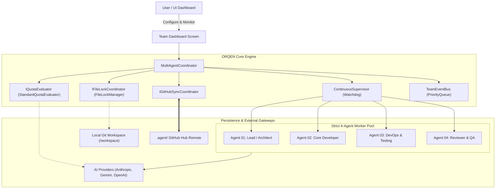
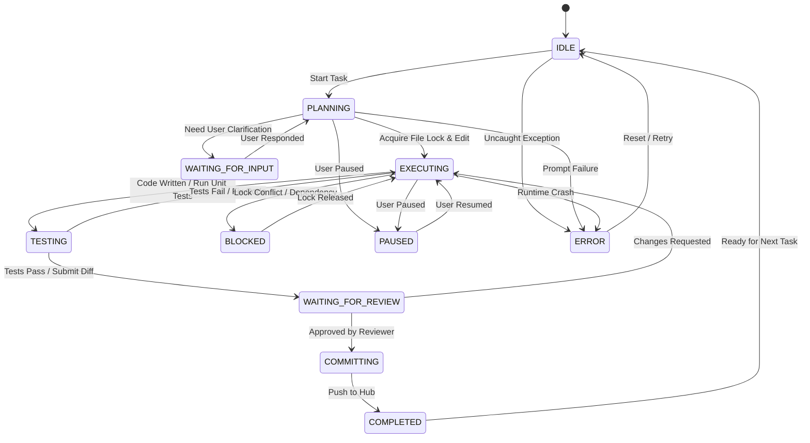
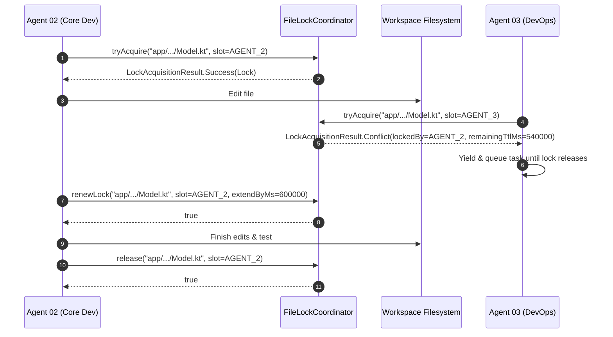
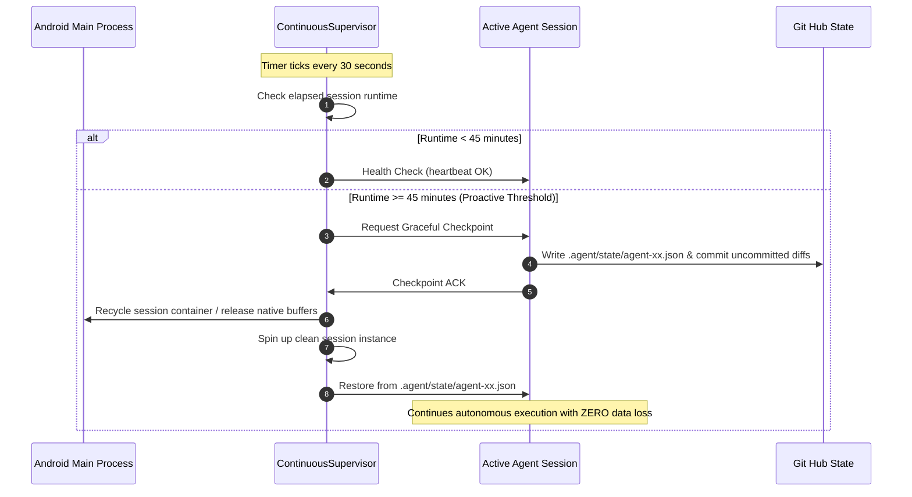

# ORQEN Multi-Agent Workspace — Part 02 Architecture Design & Component Interfaces

**Project:** ORQEN Multi-Agent Workspace (Evolved from Mobile Harness)  
**Author:** AI Architecture & Core Engineering Team  
**Date:** November 2026  
**Status:** Approved & Verified (All Contracts Tested)

---

## 1. Executive Summary & Architectural Goals

The ORQEN platform transforms Mobile Harness from a single-session Android agent harness into a production-ready **4-Agent Collaborative AI Workspace**. The architecture guarantees:

1. **Strict 4-Agent Concurrency Cap (`AgentSlot`)**: Explicit hardware- and context-aware boundaries for 4 active agents (`AGENT_1` Team Leader, `AGENT_2` Core Dev, `AGENT_3` DevOps & Test, `AGENT_4` Code Reviewer & QA).
2. **Deterministic Lifecycle State Machine (`AgentLifecycleStateMachine`)**: 11 validated states preventing deadlocks, zombie threads, and conflicting states.
3. **Robust Concurrency & File Lock Coordination (`IFileLockCoordinator`)**: Path-normalized distributed file locks with TTL, conflict reporting, heartbeat renewals, and slot-based bulk release.
4. **Transparent 3-Tier Quota Tracking (`IQuotaEvaluator`)**: Provider-reported live quotas, mathematical token rate estimations (USD & THB @ 35.0 THB/USD), and local SQLite/JSON historical rollups.
5. **Continuous Autonomous Execution**: Proactive checkpointing at 45 minutes to defeat the Android PRoot 1-hour process termination ceiling without losing active state or requiring manual user "Continue" prompts.
6. **Decoupled GitHub Synchronization (`IGitHubSyncCoordinator`)**: Structured repository-as-bus pattern using `.agent/` coordination directories.

---

## 2. High-Level System Architecture



---

## 3. Component Interfaces & Contracts

### 3.1 Agent Lifecycle State Machine

The agent lifecycle is governed by `AgentLifecycleStateMachine` enforcing safe state transitions:



#### State Definitions
| State | Activity Mapping | Description |
|---|---|---|
| `IDLE` | `IDLE` | Agent is idle waiting for work allocation. |
| `PLANNING` | `PLANNING` | Analyzing requirements, exploring codebase, creating implementation plans. |
| `EXECUTING` | `WRITING_CODE` | Modifying files, creating components, applying patches. |
| `TESTING` | `TESTING` | Executing unit and integration tests. |
| `WAITING_FOR_INPUT` | `WAITING_FOR_USER` | Suspended awaiting interactive user decision. |
| `WAITING_FOR_REVIEW` | `REVIEWING` | Awaiting review from Agent 04 / human peer. |
| `COMMITTING` | `COMMITTING` | Generating commit messages, staging, and pushing to Git. |
| `BLOCKED` | `PAUSED` | Waiting on resource lock or upstream agent deliverable. |
| `PAUSED` | `PAUSED` | Temporarily stopped by user or supervisor. |
| `COMPLETED` | `IDLE` | Task successfully completed and merged. |
| `ERROR` | `ERROR` | Fault encountered; diagnostic logged and retry evaluated. |

---

### 3.2 Concurrency & File Lock Architecture (`IFileLockCoordinator`)

To prevent multiple agents from overwriting the same code simultaneously, all file write operations must pass through `IFileLockCoordinator`:

```kotlin
interface IFileLockCoordinator {
    fun tryAcquire(
        filePath: String,
        slot: AgentSlot,
        taskId: String,
        reason: String = "Editing",
        ttlMs: Long = 10 * 60 * 1000L,
    ): LockAcquisitionResult

    fun renewLock(filePath: String, slot: AgentSlot, extendByMs: Long): Boolean
    fun release(filePath: String, slot: AgentSlot): Boolean
    fun releaseAllForAgent(slot: AgentSlot): Int
    fun isLockedByOther(filePath: String, slot: AgentSlot): Boolean
    fun getActiveLocks(): List<FileLock>
}
```

#### Lock Acquisition Flow:


---

### 3.3 Three-Tier Quota & Cost Evaluator (`IQuotaEvaluator`)

ORQEN establishes an accurate, transparent quota and cost management engine:

1. **Tier 1 — Provider-Reported Limits**:
   - HTTP response headers (e.g., `x-ratelimit-remaining-tokens`, `anthropic-ratelimit-requests-remaining`).
   - Direct provider quota balance APIs.
2. **Tier 2 — Token Rate Estimation**:
   - Live token tracking during streaming completions.
   - Dual-currency reporting: USD and Thai Baht (THB) computed via exchange rate matrix ($1.00 USD = 35.00 THB).
3. **Tier 3 — Historical Usage Rollup**:
   - Session-level, agent-level, and project-level aggregates persisted locally to survive restarts.

#### Standard Pricing Table (per 1 Million Tokens):
| Model Family | Input Cost (USD) | Output Cost (USD) | Input Cost (THB) | Output Cost (THB) |
|---|---|---|---|---|
| **Gemini 2.5 Flash / 3.8 Flash** | $0.075 | $0.30 | ฿2.625 | ฿10.50 |
| **Gemini 2.5 Pro** | $1.250 | $5.00 | ฿43.750 | ฿175.00 |
| **Claude Sonnet 3.5 / 4.6** | $3.000 | $15.00 | ฿105.000 | ฿525.00 |
| **Claude Haiku 3.5** | $0.800 | $4.00 | ฿28.000 | ฿140.00 |
| **GPT-4o / Compatible** | $2.500 | $10.00 | ฿87.500 | ฿350.00 |
| **GPT-4o-mini** | $0.150 | $0.60 | ฿5.250 | ฿21.00 |

---

### 3.4 Continuous Autonomous Supervisor Architecture

Addressing the **1-Hour Android PRoot Termination Limit**:



---

## 4. GitHub Hub Collaboration Structure

The repository uses `.agent/` as the synchronization bus:
- `communication/inbox/agent-0X/`: Incoming messages, task delegations, review requests.
- `communication/outbox/agent-0X/`: Dispatched events, status broadcasts.
- `instructions/`: Canonical role profiles (`AGENT_01_LEADER.md` to `AGENT_04_REVIEWER.md`).
- `management/`: `PROJECT_STATUS.md`, `CURRENT_TASK.md`, `TASK_QUEUE.md`.
- `state/agent-0X.json`: Live state machine snapshots for instant crash recovery.

---

## 5. Verification & Test Coverage Summary

Component interfaces were implemented and tested with JUnit 4 unit tests:
- `AgentLifecycleStateMachineTest`: Validates valid transitions and throws `IllegalStateException` on disallowed transitions.
- `FileLockCoordinatorTest`: Validates exclusive ownership, conflict detection with TTL remaining, renewal, and clean release.
- `StandardQuotaEvaluatorTest`: Validates token arithmetic, fallback pricing, and exact USD-to-THB conversions.
- `PrioritizedCollaborationEventTest`: Validates event prioritization (CRITICAL > HIGH > NORMAL > LOW).
