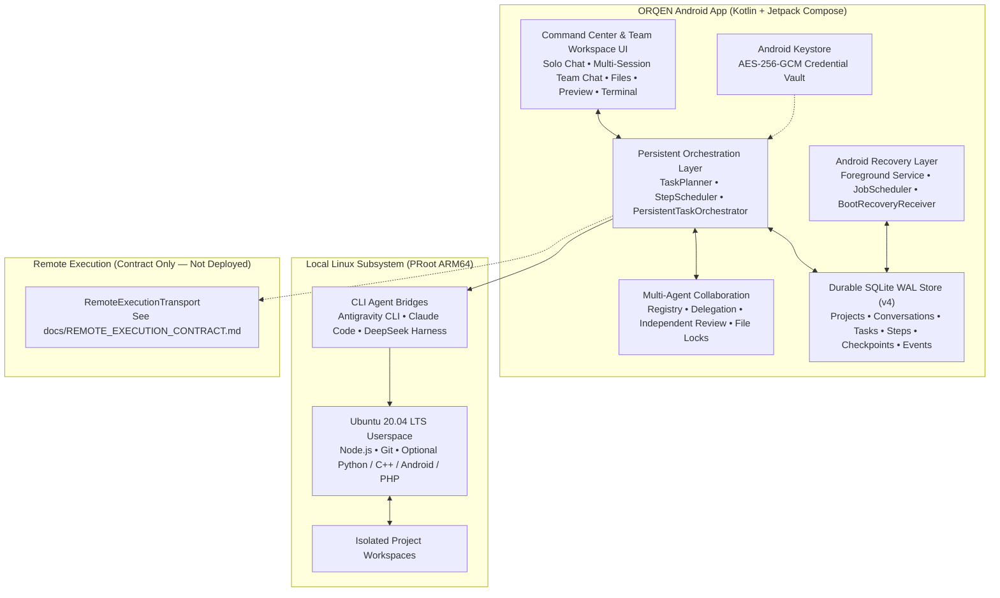

<div align="center">

  

  # ORQEN

  ### *Persistent Multi-Agent AI Development Platform for Android*

  **Application ID:** `com.orqen.app` &nbsp;•&nbsp; **Platform:** Android 9+ (`arm64-v8a`) &nbsp;•&nbsp; **License:** [MIT](LICENSE)

  <br />

  [**Core Features**](#core-features) &nbsp;•&nbsp;
  [**Architecture**](#architecture) &nbsp;•&nbsp;
  [**System Requirements**](#system-requirements) &nbsp;•&nbsp;
  [**Build from Source**](#build-from-source) &nbsp;•&nbsp;
  [**Security & Limitations**](#security--limitations) &nbsp;•&nbsp;
  [**License & Attribution**](#license--attribution)

</div>

---

## Introduction

**ORQEN** is a local-first, autonomous AI Agent Development Platform for ARM64 Android devices. It combines a Jetpack Compose workspace, a durable SQLite task orchestration engine, dynamic multi-agent collaboration, multi-session project chats, and a rootless Ubuntu 20.04 LTS subsystem running via PRoot — allowing developers to plan, build, review, test, and preview software directly on Android.

ORQEN separates four independent lifecycles — **Project**, **Conversation**, **Task**, and **Model Request** — so closing a chat or encountering a single model request timeout does not destroy ongoing work.

---

## Core Features

### Implemented Capabilities

- **Durable Task Foundation (SQLite WAL v4)**: Persists projects, conversations, tasks, many-to-many task-conversation links, ordered DAG steps, agent execution records, SHA-256 checkpoint metadata, structured agent messages, append-only task events, and an idempotency ledger with non-destructive migrations (`v1 → v4`).
- **Stateful Step Execution Engine**: Structured `TaskPlanner` & `PlanValidator`, `DependencyResolver` (sequential & diamond DAGs with cycle detection), `StepScheduler` with atomic lease claiming, configurable per-request `RequestExecutionPolicy`, `StructuredErrorClassifier`, `ResultVerifier`, and Pause / Resume / Stop / Retry controls.
- **Dynamic Multi-Agent Collaboration**: Configurable team sizes (not hardcoded to 2 or 4 agents), `AgentRegistry`, capability-based `AgentCapabilityResolver`, `AgentDelegationManager`, `AgentCommunicationManager` with per-agent context isolation, independent `AgentReviewManager` (blocks self-approval), evidence-based `AgentConsensusManager`, `AgentWorkspaceCoordinator` file locks, and `AgentResourceManager` concurrency limits.
- **Multi-Session Project Chat**: Multiple independent conversations per project, `TaskReferenceResolver` for continuing an existing `Task ID` from a new chat without duplicating work, 4-tier `HierarchicalMemoryManager` with automatic context compaction, project-scoped search, and paginated history.
- **Android Process Resilience & Recovery**: `ProcessRecoveryCoordinator`, `ExecutionLivenessMonitor`, `RuntimeExecutionService` (Foreground Service with Pause/Resume/Stop notification actions and bounded WakeLock), native Android `JobScheduler` reconciliation (`TaskRecoveryJobService`), and Play-Store-compliant `BootRecoveryReceiver`.
- **Command Center & Workspace UI**: Responsive Jetpack Compose UI (Bottom Navigation on phones, NavigationRail on tablets), Solo & AI Team Workspaces, live Web & App Preview, real Linux PRoot terminal, file explorer, and English + Thai localization.
- **Provider & Agent Integrations**: Supports Antigravity CLI, Claude Code, DeepSeek Harness, Anthropic API, OpenAI-compatible APIs, OpenRouter, Gemini, and custom endpoints with hardware-backed Android Keystore encryption.

### Infrastructure-Dependent / Not Yet Deployed

- **Remote Execution Host**: The mobile client abstraction (`ExecutionHost`, `LocalAndroidExecutionHost`, `RemoteExecutionHost`, `RemoteExecutionTransport`) and protocol specification ([docs/REMOTE_EXECUTION_CONTRACT.md](docs/REMOTE_EXECUTION_CONTRACT.md)) are implemented and unit-tested, **but no external remote worker server is deployed in this repository**. Off-device execution while the phone is powered off or force-stopped requires deploying a compatible remote backend.

---

## Architecture



---

## System Requirements

| Requirement | Minimum | Recommended |
| :--- | :--- | :--- |
| **Operating System** | Android 9.0 (API 28) | Android 13+ (API 33+) |
| **CPU Architecture** | 64-bit ARM (`arm64-v8a`) | 8-core ARM64 |
| **Compile / Target SDK** | `compileSdk 36`, `minSdk 28` | `targetSdk 28` (direct APK) / `36` (`-PplayBuild=true`) |
| **RAM** | 4 GB | 8 GB+ |
| **Storage** | 2.5 GB free | 8 GB+ (for optional toolchains & caches) |

---

## Installation

ORQEN does not currently publish prebuilt GitHub release APKs from this repository. Build the debug APK directly from source using the instructions below.

---

## Build from Source

### Prerequisites
- **JDK**: 17
- **Android SDK**: API Level 36 (`compileSdk = 36`)
- **Android NDK**: `28.2.13676358` (supports 16 KB page-size alignment for the static PRoot loader; override with `-PmhNdkVersion=<version>`)
- **CMake**: `3.22.1`

### Build & Test Commands

```bash
# Build the online-flavor debug APK
./gradlew assembleOnlineDebug

# Output APK path:
# app/build/outputs/apk/online/debug/app-online-debug.apk

# Install onto a connected ARM64 Android device
adb install -r app/build/outputs/apk/online/debug/app-online-debug.apk

# Run unit tests (including Phases 1–7 Multi-Agent & Persistence suites)
./gradlew testOnlineDebugUnitTest

# Run Android Lint checks
./gradlew lintOnlineDebug
```

> Note: Building the `offline` flavor (`assembleOfflineDebug`) requires the pre-packaged `.tar.zst` runtime archives inside `dist/runtime-bundles/`.

---

## Configuration

1. Launch ORQEN and complete the initial runtime setup.
2. Open **Settings → Providers** to configure your API keys (Anthropic, OpenRouter, OpenAI-compatible, Gemini, DeepSeek, or Custom) or sign in via the official **Antigravity CLI** / **Claude Code** flows.
3. API keys are encrypted via Android Keystore (`ApiKeyVault`) and masked in UI display (`SecretSanitizer` redacts keys/tokens before any task metadata, error message, or event log is persisted). Never commit real API keys to the repository.

---

## Project Structure

- [`app/src/main/java/com/jarves/mh/multiagent/persistence/`](app/src/main/java/com/jarves/mh/multiagent/persistence) — Durable SQLite v4 database, entities, repositories, and legacy migration
- [`app/src/main/java/com/jarves/mh/multiagent/engine/`](app/src/main/java/com/jarves/mh/multiagent/engine) — Task planner, DAG dependency resolver, atomic scheduler, verifier, checkpoints, and orchestrator
- [`app/src/main/java/com/jarves/mh/multiagent/collab/`](app/src/main/java/com/jarves/mh/multiagent/collab) — Dynamic multi-agent registry, delegation, peer review, consensus, and file locking
- [`app/src/main/java/com/jarves/mh/multiagent/session/`](app/src/main/java/com/jarves/mh/multiagent/session) — Multi-session chat controller, task reference resolver, and hierarchical memory compaction
- [`app/src/main/java/com/jarves/mh/multiagent/recovery/`](app/src/main/java/com/jarves/mh/multiagent/recovery) — Android process recovery coordinator, liveness monitor, and recovery policy
- [`app/src/main/java/com/jarves/mh/multiagent/host/`](app/src/main/java/com/jarves/mh/multiagent/host) — `ExecutionHost` abstraction (`LocalAndroidExecutionHost` and `RemoteExecutionHost` client adapter)
- [`app/src/main/java/com/jarves/mh/multiagent/ui/`](app/src/main/java/com/jarves/mh/multiagent/ui) — Command Center UI, design system, team workspace, and group chat screens
- [`app/src/main/java/com/jarves/mh/runtime/`](app/src/main/java/com/jarves/mh/runtime) — PRoot runtime bridges, `TeamAgentRunner`, `RuntimeExecutionService`, `TaskRecoveryJobService`, and `BootRecoveryReceiver`
- [`docs/REMOTE_EXECUTION_CONTRACT.md`](docs/REMOTE_EXECUTION_CONTRACT.md) — Remote Execution Host backend API contract

---

## Security & Limitations

- **PRoot Boundary**: PRoot runs in Android userspace without root privileges; it is **not** a hardware VM or hardened kernel sandbox. Only run repositories and build scripts you trust.
- **Android Force-Stop & Power-Off**: Android blocks all background services, jobs, and boot receivers if a user explicitly **Force Stops** the app or powers off the device. ORQEN does not attempt to bypass OS restrictions; eligible tasks reconcile automatically when the app is launched again.
- **Credential Protection**: Secrets are stored in Android Keystore (`ApiKeyVault`) and automatically redacted by `SecretSanitizer` prior to persistence in task logs or events.
- **Privacy Policy**: See [PRIVACY.md](PRIVACY.md).

---

## License & Attribution

Licensed under the [MIT License](LICENSE).

ORQEN originated as an independent fork of the open-source [Mobile Harness](https://github.com/techjarves/Mobile-Harness) project by TechJarves (Copyright © 2026 Mobile Harness Contributors / TechJarves, MIT License). ORQEN is an independent product and is not affiliated with, endorsed by, or sponsored by TechJarves. Third-party open-source licenses are included in [`app/src/main/assets/licenses`](app/src/main/assets/licenses).
