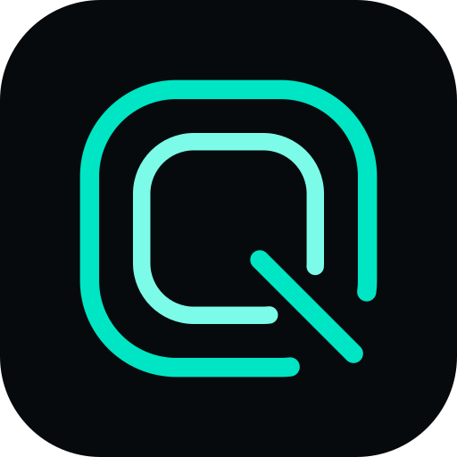
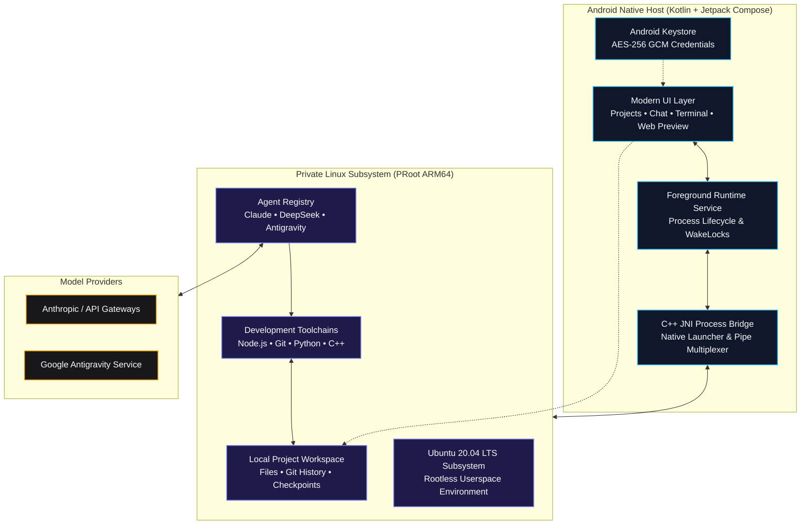

<div align="center">

  

  # ORQEN

  ### *Think Together. Build Anything.*

  **A Premium AI Collaboration Workspace for Android.**

  Chat with coding agents, manage workspaces, execute real Linux commands, and preview live web servers — directly on your mobile device.

  <br />

  [](#system-requirements)
  [](#system-requirements)
  [](LICENSE)
  [](BRAND_IDENTITY.md)

  <br />

  [**Download Online APK**](https://github.com/techjarves/Mobile-Harness/releases/latest/download/mobile-harness-online.apk) &nbsp;•&nbsp;
  [**Quickstart Guide**](#quickstart) &nbsp;•&nbsp;
  [**Architecture**](#architecture) &nbsp;•&nbsp;
  [**Build from Source**](#developer-guides) &nbsp;•&nbsp;
  [**Rebranding Report**](REBRANDING_REPORT.md)

</div>

<br />

---

> [!IMPORTANT]
> **Environment Security Notice**  
> ORQEN runs on **ARM64 Android devices** using a private userspace PRoot layer. While isolated from other apps via standard Android sandbox permissions, PRoot is not a virtualization boundary or hardened security jail. Only execute projects and dependencies you own or trust.

<br />

## About ORQEN

**ORQEN** is a premium, local-first AI collaboration workspace engineered for ARM64 Android devices. It unites a modern Jetpack Compose interface with a self-contained, rootless **Ubuntu 20.04 LTS subsystem** running via PRoot. ORQEN enables software engineering workflows on Android without requiring root access, unlocked bootloaders, or external applications like Termux.

ORQEN is an independent product and fork originating from the open-source [Mobile Harness](https://github.com/techjarves/Mobile-Harness) project by TechJarves. See [Upstream Attribution & Open Source](#upstream-attribution--open-source) below.

<br />

## Verified Capabilities

<table>
  <tr>
    <td width="50%" valign="top">
      <h3>Autonomous Agent Coding</h3>
      <p>Native integrations with Claude Code, DeepSeek Harness, and Antigravity CLI. Each agent has an isolated driver, settings, and resumable project conversations.</p>
    </td>
    <td width="50%" valign="top">
      <h3>Isolated Linux Subsystem</h3>
      <p>A full Ubuntu 20.04 ARM64 userspace running inside PRoot. Includes Node.js, npm, Git, OpenSSL, and essential shell tooling out of the box.</p>
    </td>
  </tr>
  <tr>
    <td width="50%" valign="top">
      <h3>Instant Web Preview</h3>
      <p>Spun up a Vite, Next.js, or Express server? Test web interfaces in real-time within a restricted, sandboxed mobile WebView with console telemetry.</p>
    </td>
    <td width="50%" valign="top">
      <h3>Keystore-Grade Encryption</h3>
      <p>Your API keys and credentials are encrypted using Android Keystore-backed AES-256 GCM. No telemetry, no remote proxies, and zero plain-text leaks.</p>
    </td>
  </tr>
  <tr>
    <td width="50%" valign="top">
      <h3>Persistent Project Sessions</h3>
      <p>Keep projects, chat history, files, and task context together so work can continue across app sessions.</p>
    </td>
    <td width="50%" valign="top">
      <h3>Native File Workflow</h3>
      <p>Browse, edit, search, and attach files directly from the app interface. Interoperate with system storage via Android Storage Access Framework (SAF).</p>
    </td>
  </tr>
  <tr>
    <td width="50%" valign="top">
      <h3>On-device Android Builds</h3>
      <p>Build, install, and launch Android APKs directly on the phone without USB or wireless ADB pairing.</p>
    </td>
    <td width="50%" valign="top">
      <h3>Optional Toolchains</h3>
      <p>Add Python, Android, C/C++, and PHP tooling only when a project needs it.</p>
    </td>
  </tr>
</table>

<br />

## Workspace Interface

<table>
  <tr>
    <th width="33%" align="center">Projects</th>
    <th width="33%" align="center">Terminal</th>
    <th width="33%" align="center">Settings</th>
  </tr>
  <tr>
    <td align="center" valign="top">
      
    </td>
    <td align="center" valign="top">
      
    </td>
    <td align="center" valign="top">
      
    </td>
  </tr>
  <tr>
    <td align="center"><sub>Create, organize, and resume isolated workspace sessions.</sub></td>
    <td align="center"><sub>Execute real Linux commands and scripts with instant output.</sub></td>
    <td align="center"><sub>Manage AI providers, installed toolchains, themes, and runtime health.</sub></td>
  </tr>
</table>

<br />

## Quickstart

Get up and running in 3 guided steps:

### 1. Download & Install
Install the signed debug or release APK on your ARM64 Android phone.

```text
Target Architecture : ARM64 (arm64-v8a)
Application ID      : com.orqen.app
Minimum OS Level    : Android 9.0 (API 28)
```

### 2. Guided Bootstrap (~10 Minutes)
Launch ORQEN and follow the interactive setup wizard:

<table>
  <tr>
    <th width="33%" align="center">1 · System Readiness</th>
    <th width="33%" align="center">2 · Toolchains</th>
    <th width="33%" align="center">3 · AI Provider</th>
  </tr>
  <tr>
    <td align="center" valign="top">
      
    </td>
    <td align="center" valign="top">
      
    </td>
    <td align="center" valign="top">
      
    </td>
  </tr>
  <tr>
    <td align="center"><sub>Verifies device storage, CPU architecture, and background service permissions.</sub></td>
    <td align="center"><sub>Select core Ubuntu runtime and optional development stacks.</sub></td>
    <td align="center"><sub>Securely store your API keys in Android Keystore.</sub></td>
  </tr>
</table>

### 3. Create & Build
1. Tap **New Project** or launch an instant **Quick Project**.
2. Open the **AI Workspace** and describe what you want to build.
3. Watch the agent inspect files, draft code, run builds, and launch local web previews.

<br />

## Model Providers & Agents

ORQEN supports direct API keys, compatibility gateways, and CLI agent backends:

| Provider | Integration Type | Streaming | Tool Calling | Status | Notes |
| :--- | :---: | :---: | :---: | :---: | :--- |
| **Anthropic API** | Direct Key | Supported | Supported | `Recommended` | Primary supported backend |
| **OpenRouter** | Gateway | Supported | Supported | `Supported` | Routes compatible models through one API key |
| **DeepSeek** | Direct Key | Supported | Supported | `Supported` | Anthropic-compatible endpoint |
| **Kimi** | Direct Key | Supported | Supported | `Supported` | Anthropic-compatible Moonshot endpoint |
| **Custom API** | Endpoint Override | Compatible | Compatible | `Experimental` | User-configured gateway |

> [!NOTE]
> API keys are stored with hardware-backed Android Keystore AES-256-GCM encryption. Antigravity Google OAuth credentials are created and retained only by the official `agy` CLI in its persistent Linux home; ORQEN never reads or copies its tokens.

### Supported Coding Agents

| Agent | Authentication | Installation | Isolation |
| :--- | :--- | :--- | :--- |
| **Claude Code** | Claude account or API-key providers | Included in Core | Existing Claude bridge and settings |
| **DeepSeek Harness** | API-key providers | On demand | Existing DSH bridge and settings |
| **Antigravity CLI** | Official Google OAuth flow | Version-pinned online download | Dedicated `agy` bridge, model, effort, and conversation IDs |

For Antigravity, select **Antigravity CLI**, install it, and tap **Sign in with Google**. ORQEN starts the official CLI login, opens the freshly generated Google URL in the system browser, and sends the returned one-time code back to that waiting process. The app does not embed Google login in a WebView and does not construct its own OAuth request.

<br />

## Architecture

ORQEN bridges native Android Jetpack Compose to an isolated PRoot Linux execution layer via an optimized C++ JNI bridge:



### Core Runtime Components
* **Base Environment**: Ubuntu 20.04 ARM64 verified rootfs
* **Agent Engine**: Registry-selected, isolated drivers for Claude Code, DeepSeek Harness, and the official Antigravity CLI
* **Native Tooling**: Node.js LTS, npm, Git, OpenSSL, curl, and GNU coreutils
* **Process Virtualization**: PRoot user-space architecture emulation with zero kernel modifications

<br />

## System Requirements

| Metric | Minimum Specification | Recommended Specification |
| :--- | :--- | :--- |
| **Operating System** | Android 9.0 (API level 28) | Android 13.0+ (API level 33+) |
| **CPU Architecture** | 64-bit ARM (`arm64-v8a`) | High-performance 8-Core ARM64 (Snapdragon 8 Gen 1+ / Dimensity) |
| **RAM** | 4 GB | 8 GB or more |
| **Free Storage** | 2.5 GB (Base Runtime) | 8.0 GB+ (For multi-language toolchains and build caches) |
| **Network** | Stable connection for setup & API | High-speed Wi-Fi during initial rootfs provisioning |

<br />

---

## Developer Guides

<details>
<summary><b>Building from source (Android Studio & NDK)</b></summary>

<br />

### Prerequisites
* **Android SDK**: API Level 36 (`compileSdk 36`)
* **Java Development Kit**: JDK 17 (Eclipse Temurin or OpenJDK)
* **Android NDK**: `28.2.13676358` (or configured via `-PmhNdkVersion`)
* **CMake**: `3.22.1`

### Build Debug APK
```bash
# Build the standard ARM64 debug binary
./gradlew assembleDebug

# Deploy directly to a connected test device
adb install -r app/build/outputs/apk/online/debug/ORQEN-online-debug.apk
```

### Quality Assurance & Testing
```bash
# Run unit tests
./gradlew testDebugUnitTest

# Run static analysis linter
./gradlew lintDebug
```

</details>

<details>
<summary><b>Optional toolchains and development stacks</b></summary>

<br />

ORQEN allows downloading optional developer packs on demand to conserve space:

* **Python Suite**: Python 3.10+, pip, virtualenv, and essential scientific C-extensions.
* **Android & JVM**: OpenJDK 17 headless runtime and Gradle build tools.
* **C / C++ Compiler Suite**: GCC/G++, Clang, Make, and CMake for native tool compilation.
* **PHP Development**: PHP CLI runtime, Composer, and standard database extensions.

> *Note: Kernel-level virtualization technologies such as Docker, KVM, systemd services, and nested hardware emulators are not supported under PRoot.*

</details>

<details>
<summary><b>Security model and data privacy</b></summary>

<br />

* **Zero Cloud Intermediaries**: ORQEN connects your device directly to your chosen AI endpoint. No intermediate relays or telemetry servers collect your prompts or code.
* **Scoped Storage**: Project imports and exports utilize Android's official Storage Access Framework (SAF) instead of broad shared storage access.
* **Cryptographic Checksums**: Root filesystem archives and Claude Code CLI packages are verified via SHA-256 checksums prior to extraction.
* **Encrypted Secrets**: API tokens are encrypted in hardware-backed storage via Android Keystore.

Read our complete [Privacy Policy](PRIVACY.md).

</details>

<br />

## Upstream Attribution & Open Source

ORQEN is built upon the open-source foundation of **Mobile Harness**, originally developed and maintained by **TechJarves** ([github.com/techjarves/Mobile-Harness](https://github.com/techjarves/Mobile-Harness)).

We acknowledge and credit the original creators and contributors of Mobile Harness for their architectural work, PRoot Android port, and local-first AI development tools. ORQEN is an independent product and fork; it is not affiliated with, endorsed by, or sponsored by TechJarves.

- Original Codebase: [https://github.com/techjarves/Mobile-Harness](https://github.com/techjarves/Mobile-Harness)
- Original Copyright: Copyright (c) 2026 Mobile Harness Contributors / TechJarves
- License: MIT License (see [LICENSE](LICENSE))

## Legal & Trademarks

* **Claude** and **Claude Code** are trademarks of Anthropic, PBC. Claude Code CLI is downloaded directly from Anthropic's official distribution endpoints during setup and remains governed by Anthropic's license terms.
* **Antigravity CLI** and Android are trademarks of Google LLC.
* **DeepSeek** and DeepSeek Harness are property of their respective owners.
* Ubuntu, Linux, Kotlin, Node.js, Git, and other registered trademarks belong to their respective copyright holders.
* Third-party open-source licenses are compiled in [`app/src/main/assets/licenses`](app/src/main/assets/licenses).

<br />

## License

This project is licensed under the [MIT License](LICENSE). Third-party runtime binaries and packages remain governed by their respective upstream licenses.

---

<div align="center">
  <strong>ORQEN</strong> — <em>Think Together. Build Anything.</em><br />
  <sub>Premium AI Collaboration Workspace for Android</sub>
</div>
